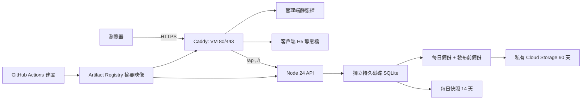

# Google Cloud 正式部署

正式專案 `dualplate-511819`，香港 `asia-east2-a`。API 與 SQLite 在 Compute Engine `dualplate-app`；資料庫只在獨立的 `dualplate-data` 持久磁碟。管理端與客戶端 H5 由同一個 Caddy 映像提供，`/api` 同站轉發，客戶端 `/r/` 轉發至 API。映像放 Artifact Registry，秘密放 Secret Manager，備份傳至私有 Cloud Storage。



## 網址與檢查

- 客戶端：`https://dualplate.masterappinc.com`
- 管理端：`https://dualplateadmin.masterappinc.com`
- 健康：兩個網域的 `/api/health` 應回 `{"ok":true,"database":"ok"}`。首頁應回 200，`index.html` 是 `no-store`，`/assets/` 可永久快取。
- 承租方專屬連結：客戶端網域的 `/r/<令牌>`。

## 發布與回滾

推送 `main` 後，`.github/workflows/deploy-production.yml` 先執行 API 測試、管理端 check/build、客戶端 H5 build 和腳本語法檢查。`DEPLOY_ENABLED=true` 才在 GitHub 機器上以 `docker buildx` 建置兩個映像並推送到 Artifact Registry（同 MasterDriver）。`.dockerignore` 排除本機資料、SQLite、測試樣本與秘密。發布前再檢查 commit 仍是 `main` 最新，通過後經 IAP SSH 呼叫 VM 的 `/srv/dualplate/deploy.sh <API@sha256> <web@sha256>`。腳本先備份 SQLite 並上傳 GCS；新容器健康檢查失敗，便切回舊摘要。首次沒有資料庫時跳過發布前備份，API 首次啟動建立空資料庫。

手動回滾：

```bash
gcloud compute ssh dualplate-app --project=dualplate-511819 --zone=asia-east2-a --tunnel-through-iap --command='sudo /srv/dualplate/rollback.sh <舊API映像@sha256> <舊web映像@sha256>'
```

摘要可從 Artifact Registry 或之前的 GitHub Actions 日誌取得。回滾程式不會回滾 SQLite 結構；如需還原資料，先停止容器並由負責人核對備份。

`deploy.sh` 結束碼：`0` 新版健康；`1` 缺少必要參數／環境變數或其他命令錯誤；`2` 摘要格式錯；`3` 另一次發布佔用鎖；`4` 發布前備份失敗或既有版本缺資料庫；`5` 新版容器啟動失敗、舊版已恢復健康；`6` 新版健康檢查失敗、舊版已恢復健康；`7` 新版失敗且舊版恢復後仍不健康；`8` 首次發布失敗、沒有舊版可切回；`9` 無法拉取映像。腳本會明確記錄 `Rollback healthy` 或 `Rollback unhealthy`。

## 一次性設定（新專案重建時逐條執行）

以下命令不含秘密內容。正式專案目前已建立這些資源；重建時先確認沒有同名資源。使用有專案管理權限的 Google 帳號登入 `gcloud`。

```bash
export PROJECT_ID=dualplate-511819
export REGION=asia-east2
export ZONE=asia-east2-a
gcloud config set project "$PROJECT_ID"
gcloud services enable compute.googleapis.com artifactregistry.googleapis.com logging.googleapis.com secretmanager.googleapis.com iam.googleapis.com iamcredentials.googleapis.com sts.googleapis.com storage.googleapis.com
gcloud artifacts repositories create dualplate --location="$REGION" --repository-format=docker
gcloud storage buckets create "gs://${PROJECT_ID}-backups" --location="$REGION" --uniform-bucket-level-access --public-access-prevention
printf '%s\n' '{"rule":[{"action":{"type":"Delete"},"condition":{"age":90}}]}' > /tmp/dualplate-lifecycle.json
gcloud storage buckets update "gs://${PROJECT_ID}-backups" --lifecycle-file=/tmp/dualplate-lifecycle.json
gcloud compute addresses create dualplate-public-ip --region="$REGION"
gcloud compute disks create dualplate-data --zone="$ZONE" --size=20GB --type=pd-balanced
gcloud compute resource-policies create snapshot-schedule dualplate-data-daily --region="$REGION" --start-time=19:00 --daily-schedule --max-retention-days=14 --on-source-disk-delete=keep-auto-snapshots
gcloud compute disks add-resource-policies dualplate-data --zone="$ZONE" --resource-policies=dualplate-data-daily
gcloud iam service-accounts create dualplate-vm
gcloud iam service-accounts create dualplate-deploy
```

19:00 UTC 是香港次日 03:00。Debian 12 `cron` 不支援 `CRON_TZ`，所以 `bootstrap.sh` 把主機時區設為 UTC，`deploy/vm/backup.cron` 使用 19:15，對應香港次日 03:15，執行 SQLite 線上備份與 GCS 上傳。授權：VM 帳戶只需讀映像、讀 `dualplate-app-env` Secret、對備份 bucket 使用 `roles/storage.objectUser`（上傳後核對物件需要讀取）；部署帳戶在 GitHub 機器上推送映像（Artifact Registry 寫入）、經 IAP SSH 登入 VM，不讀 Secret 內容。以下指令逐條設定：

```bash
VM_SA="dualplate-vm@${PROJECT_ID}.iam.gserviceaccount.com"
DEPLOY_SA="dualplate-deploy@${PROJECT_ID}.iam.gserviceaccount.com"
gcloud artifacts repositories add-iam-policy-binding dualplate --location="$REGION" --member="serviceAccount:${VM_SA}" --role=roles/artifactregistry.reader
gcloud artifacts repositories add-iam-policy-binding dualplate --location="$REGION" --member="serviceAccount:${DEPLOY_SA}" --role=roles/artifactregistry.writer
gcloud storage buckets add-iam-policy-binding "gs://${PROJECT_ID}-backups" --member="serviceAccount:${VM_SA}" --role=roles/storage.objectUser
gcloud projects add-iam-policy-binding "$PROJECT_ID" --member="serviceAccount:${DEPLOY_SA}" --role=roles/compute.osAdminLogin --condition=None
gcloud projects add-iam-policy-binding "$PROJECT_ID" --member="serviceAccount:${DEPLOY_SA}" --role=roles/iap.tunnelResourceAccessor --condition=None
gcloud projects add-iam-policy-binding "$PROJECT_ID" --member="serviceAccount:${DEPLOY_SA}" --role=roles/compute.viewer --condition=None
gcloud iam service-accounts add-iam-policy-binding "$VM_SA" --member="serviceAccount:${DEPLOY_SA}" --role=roles/iam.serviceAccountUser
```

`dualplate-app-env` 的內容由負責人在本機建立暫存檔。以下範本沒有秘密值；若要啟用微信登入，須在本機編輯檔案填入由管理者保管的值。不要在終端機日誌、GitHub 或文件貼出秘密。完成後建立 Secret、授予 VM 存取權並刪除暫存檔：

```bash
umask 077
APP_ENV_FILE="$(mktemp "${TMPDIR:-/tmp}/dualplate-app-env.XXXXXX")"
cat > "$APP_ENV_FILE" <<'ENV'
PORT=4100
DB_PATH=/srv/dualplate/data/app.sqlite
CORS_ORIGINS=
BACKUP_DIR=/srv/dualplate/backups
BACKUP_KEEP_DAYS=90
LOG_DIR=/srv/dualplate/logs
PUBLIC_BASE_URL=https://dualplate.masterappinc.com
BUSINESS_TZ=Asia/Hong_Kong
WECHAT_APPID=
WECHAT_SECRET=
DEMO_SEED=0
ENV
chmod 600 "$APP_ENV_FILE"
${EDITOR:-vi} "$APP_ENV_FILE"
gcloud secrets create dualplate-app-env --replication-policy=automatic --data-file="$APP_ENV_FILE" --project="$PROJECT_ID"
gcloud secrets add-iam-policy-binding dualplate-app-env --project="$PROJECT_ID" --member="serviceAccount:${VM_SA}" --role=roles/secretmanager.secretAccessor
rm -f "$APP_ENV_FILE"
unset APP_ENV_FILE
```

```bash
gcloud compute firewall-rules create dualplate-web --network=default --allow=tcp:80,tcp:443 --target-tags=dualplate-web --source-ranges=0.0.0.0/0
gcloud compute firewall-rules create dualplate-iap-ssh --network=default --allow=tcp:22 --target-tags=dualplate-web --source-ranges=35.235.240.0/20
gcloud compute instances create dualplate-app --zone="$ZONE" --machine-type=e2-small --image-family=debian-12 --image-project=debian-cloud --boot-disk-size=20GB --disk=name=dualplate-data,device-name=dualplate-data,mode=rw,boot=no,auto-delete=no --address=dualplate-public-ip --service-account="$VM_SA" --scopes=https://www.googleapis.com/auth/cloud-platform --tags=dualplate-web --metadata=enable-oslogin=TRUE
```

把 `deploy/` 送至 VM 的 `/tmp/dualplate-deploy`，然後初始化。**只在確認新磁碟沒有檔案系統時**設定 `FORMAT_EMPTY_DISK=yes`；腳本遇到已有檔案系統絕不格式化。腳本安裝 Docker/Caddy 所需環境、掛載磁碟、讀 Secret 到權限 600 的 `app.env`，安裝備份 cron 和 `refresh-env.sh`。以下命令在持有 `deploy/` 的本機執行：

```bash
gcloud compute ssh dualplate-app --project="$PROJECT_ID" --zone="$ZONE" --tunnel-through-iap --command='mkdir -p /tmp/dualplate-deploy'
gcloud compute scp --recurse ./deploy/. "dualplate-app:/tmp/dualplate-deploy" --project="$PROJECT_ID" --zone="$ZONE" --tunnel-through-iap
gcloud compute ssh dualplate-app --project="$PROJECT_ID" --zone="$ZONE" --tunnel-through-iap --command='sudo blkid /dev/disk/by-id/google-dualplate-data || true'
gcloud compute ssh dualplate-app --project="$PROJECT_ID" --zone="$ZONE" --tunnel-through-iap --command="sudo DATA_DEVICE=/dev/disk/by-id/google-dualplate-data GCP_PROJECT_ID='$PROJECT_ID' FORMAT_EMPTY_DISK=yes /tmp/dualplate-deploy/vm/bootstrap.sh"
```

若 `blkid` 顯示已有檔案系統，停下核對資料，不設定 `FORMAT_EMPTY_DISK=yes`；已初始化的主機不需重新跑 `bootstrap.sh`。現有正式 VM 要套用本輪的部署腳本、`refresh-env.sh` 和修正後的備份排程，用上面的 `scp` 更新後執行：

```bash
gcloud compute ssh dualplate-app --project="$PROJECT_ID" --zone="$ZONE" --tunnel-through-iap --command='sudo install -m 0755 /tmp/dualplate-deploy/vm/refresh-env.sh /srv/dualplate/refresh-env.sh'
gcloud compute ssh dualplate-app --project="$PROJECT_ID" --zone="$ZONE" --tunnel-through-iap --command='sudo install -m 0755 /tmp/dualplate-deploy/vm/deploy.sh /srv/dualplate/deploy.sh'
gcloud compute ssh dualplate-app --project="$PROJECT_ID" --zone="$ZONE" --tunnel-through-iap --command='sudo timedatectl set-timezone Etc/UTC'
gcloud compute ssh dualplate-app --project="$PROJECT_ID" --zone="$ZONE" --tunnel-through-iap --command='sudo install -m 0644 /tmp/dualplate-deploy/vm/backup.cron /etc/cron.d/dualplate-backup && sudo systemctl restart cron'
gcloud compute ssh dualplate-app --project="$PROJECT_ID" --zone="$ZONE" --tunnel-through-iap --command='timedatectl; sudo test -f /srv/dualplate/logs/backup-cron.log && sudo tail -n 20 /srv/dualplate/logs/backup-cron.log || printf "尚無 backup-cron.log\n"'
```

Workload Identity Federation：

```bash
gcloud iam workload-identity-pools create github --location=global
gcloud iam workload-identity-pools providers create-oidc github --location=global --workload-identity-pool=github --issuer-uri=https://token.actions.githubusercontent.com --attribute-mapping='google.subject=assertion.sub,attribute.repository=assertion.repository,attribute.environment=assertion.environment,attribute.ref=assertion.ref' --attribute-condition="assertion.repository=='masterappIT/dualplate' && assertion.environment=='production' && assertion.ref=='refs/heads/main'"
PROJECT_NUMBER="$(gcloud projects describe "$PROJECT_ID" --format='value(projectNumber)')"
gcloud iam service-accounts add-iam-policy-binding "$DEPLOY_SA" --role=roles/iam.workloadIdentityUser --member="principalSet://iam.googleapis.com/projects/${PROJECT_NUMBER}/locations/global/workloadIdentityPools/github/attribute.repository/masterappIT/dualplate"
```

在 GitHub 倉庫建立 `production` 環境，只准 `main`，並設環境變數 `GCP_PROJECT_ID`、`GCP_REGION`、`GCP_ZONE`、`GCP_ARTIFACT_REPOSITORY`、`GCP_WORKLOAD_IDENTITY_PROVIDER`、`GCP_DEPLOY_SERVICE_ACCOUNT`、`GCP_VM_NAME`、`GCP_BACKUP_BUCKET`。準備好後才在倉庫層級設 `DEPLOY_ENABLED=true`。Squarespace DNS 新增兩筆 A：`dualplate`、`dualplateadmin` 指向固定 IP；不改其他紀錄。等 DNS 生效後核對兩筆都回固定 IP：

```bash
PUBLIC_IP="$(gcloud compute addresses describe dualplate-public-ip --region="$REGION" --project="$PROJECT_ID" --format='value(address)')"
printf '固定 IP：%s\n' "$PUBLIC_IP"
dig +short dualplate.masterappinc.com
dig +short dualplateadmin.masterappinc.com
```

兩個 `dig` 結果都應包含 `$PUBLIC_IP`，再檢查兩站 HTTPS 和 `/api/health`。

## 第一個管理員與還原演練

首次發布成功後，管理者在安全終端機輸入管理員名稱與密碼，不把密碼寫在命令列歷史、腳本或日誌：

```bash
gcloud compute ssh dualplate-app --project=dualplate-511819 --zone=asia-east2-a --tunnel-through-iap
read -r -p "管理員帳號：" admin_user
read -r -p "顯示名稱：" admin_name
read -r -s -p "初始密碼（至少 10 字元）：" admin_password; echo
sudo docker compose --env-file /srv/dualplate/deploy.env -f /srv/dualplate/compose.yaml exec -T \
  -e ADMIN_USERNAME="$admin_user" -e ADMIN_NAME="$admin_name" -e ADMIN_PASSWORD="$admin_password" api node src/create-admin.js
unset admin_password
```

建立管理員時使用互動輸入，避免把密碼放在 shell history。還原演練：將 GCS 的一份備份下載到隔離測試主機，對副本執行 `PRAGMA integrity_check`，啟動測試 API 並核對筆數；正式資料庫不作演練覆蓋。

### 事故還原

先核對備份日期及事故時段的操作記錄。以下命令在正式 VM 的 shell 內由負責人執行；`BACKUP_OBJECT` 填已核對的 GCS 物件名稱，不填秘密。若有現存資料庫，先保留故障檔，絕不直接覆蓋。`sqlite3` 只用於檢查下載副本。

```bash
ROOT=/srv/dualplate
BACKUP_BUCKET=dualplate-511819-backups
BACKUP_OBJECT='<已核對的備份檔名>'
sudo docker compose --env-file "$ROOT/deploy.env" -f "$ROOT/compose.yaml" stop api
sudo install -d -m 0700 "$ROOT/incident"
INCIDENT_TIME="$(date -u +%Y%m%dT%H%M%SZ)"
for suffix in '' '-wal' '-shm'; do
  if sudo test -f "$ROOT/data/app.sqlite${suffix}"; then
    sudo cp -a "$ROOT/data/app.sqlite${suffix}" "$ROOT/incident/app.sqlite.${INCIDENT_TIME}${suffix}"
  fi
done
sudo gcloud storage cp --quiet "gs://${BACKUP_BUCKET}/${BACKUP_OBJECT}" "$ROOT/incident/restore.sqlite"
sudo apt-get update
sudo apt-get install -y sqlite3
sudo sqlite3 "$ROOT/incident/restore.sqlite" 'PRAGMA integrity_check;'
```

只有 `integrity_check` 輸出 `ok` 時才繼續；否則換另一份備份。確認事故現況已保存後執行。舊的 WAL／SHM 不能和還原的資料庫混用，須在 API 已停止、舊檔已保存後移開：

```bash
sudo rm -f "$ROOT/data/app.sqlite-wal" "$ROOT/data/app.sqlite-shm"
sudo install -o 10001 -g 10001 -m 0600 "$ROOT/incident/restore.sqlite" "$ROOT/data/app.sqlite"
sudo chown 10001:10001 "$ROOT/data/app.sqlite"
sudo docker compose --env-file "$ROOT/deploy.env" -f "$ROOT/compose.yaml" up -d api
curl --fail --silent --show-error https://dualplate.masterappinc.com/api/health
curl --fail --silent --show-error https://dualplateadmin.masterappinc.com/api/health
```

兩個健康端點都應回 `{"ok":true,"database":"ok"}`；再由負責人核對客戶、牌照與操作記錄。還原資料會失去備份時間後的變更，需按操作記錄判斷補錄。

### 改設定與微信小程序

`bootstrap.sh` 只在首次讀取 Secret。之後新增微信 `WECHAT_APPID`／`WECHAT_SECRET` 或更換任何 API 環境設定時，先在本機修改權限 600 的暫存檔，再建立 `dualplate-app-env` 新版本；`refresh-env.sh` 會讀最新版本、以權限 600 原子替換 `/srv/dualplate/app.env`、只重建 `api` 容器並檢查健康。失敗時會還原舊檔案並嘗試重新啟動 API。不要把秘密直接放在命令列或日誌。

```bash
umask 077
APP_ENV_FILE="$(mktemp "${TMPDIR:-/tmp}/dualplate-app-env.XXXXXX")"
gcloud secrets versions access latest --secret=dualplate-app-env --project=dualplate-511819 > "$APP_ENV_FILE"
chmod 600 "$APP_ENV_FILE"
${EDITOR:-vi} "$APP_ENV_FILE"
gcloud secrets versions add dualplate-app-env --data-file="$APP_ENV_FILE" --project=dualplate-511819
rm -f "$APP_ENV_FILE"
unset APP_ENV_FILE
gcloud compute ssh dualplate-app --project=dualplate-511819 --zone=asia-east2-a --tunnel-through-iap --command='sudo GCP_PROJECT_ID=dualplate-511819 /srv/dualplate/refresh-env.sh'
curl --fail --silent --show-error https://dualplate.masterappinc.com/api/health
```

微信小程序的 request 合法網域須符合備案要求。`masterappinc.com` 的主機在香港、未備案；要上小程序須另備已備案網域，並完成微信平台的合法網域設定與審核。這是後續上架工作，本輪僅保留設定方法；現有兩個 H5 網址不代表小程序可直接上架。

有了已備案網域後：`cd mobile && VITE_API_BASE_URL=https://<已備案網域> npm run build:mp-weixin`，用微信開發者工具匯入 `mobile/dist/build/mp-weixin`，上傳並提交審核。客戶第一次用微信登入時，輸入顧問在管理端「客戶帳號 → 產生微信綁定碼」給的 6 位數字。
