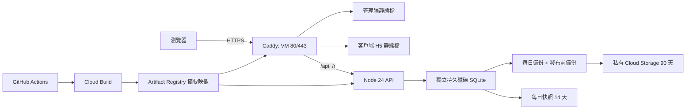

# Google Cloud 正式部署

正式專案 `dualplate-511819`，香港 `asia-east2-a`。API 與 SQLite 在 Compute Engine `dualplate-app`；資料庫只在獨立的 `dualplate-data` 持久磁碟。管理端與客戶端 H5 由同一個 Caddy 映像提供，`/api` 同站轉發，客戶端 `/r/` 轉發至 API。映像放 Artifact Registry，秘密放 Secret Manager，備份傳至私有 Cloud Storage。



## 網址與檢查

- 客戶端：`https://dualplate.masterappinc.com`
- 管理端：`https://dualplateadmin.masterappinc.com`
- 健康：兩個網域的 `/api/health` 應回 `{"ok":true,"database":"ok"}`。首頁應回 200，`index.html` 是 `no-store`，`/assets/` 可永久快取。
- 承租方專屬連結：客戶端網域的 `/r/<令牌>`。

## 發布與回滾

推送 `main` 後，`.github/workflows/deploy-production.yml` 先執行 API 測試、管理端 check/build、客戶端 H5 build 和腳本語法檢查。`DEPLOY_ENABLED=true` 才透過 Cloud Build 建置及推送兩個映像。`.gcloudignore` 排除本機資料、SQLite、測試樣本與秘密。發布前再檢查 commit 仍是 `main` 最新，通過後經 IAP SSH 呼叫 VM 的 `/srv/dualplate/deploy.sh <API@sha256> <web@sha256>`。腳本先備份 SQLite 並上傳 GCS；新容器健康檢查失敗，便切回舊摘要。首次沒有資料庫時跳過發布前備份，API 首次啟動建立空資料庫。

手動回滾：

```bash
gcloud compute ssh dualplate-app --project=dualplate-511819 --zone=asia-east2-a --tunnel-through-iap --command='sudo /srv/dualplate/rollback.sh <舊API映像@sha256> <舊web映像@sha256>'
```

摘要可從 Artifact Registry 或之前的 GitHub Actions 日誌取得。回滾程式不會回滾 SQLite 結構；如需還原資料，先停止容器並由負責人核對備份。

## 一次性設定（新專案重建時逐條執行）

以下命令不含秘密內容。正式專案目前已建立這些資源；重建時先確認沒有同名資源。使用有專案管理權限的 Google 帳號登入 `gcloud`。

```bash
export PROJECT_ID=dualplate-511819
export REGION=asia-east2
export ZONE=asia-east2-a
gcloud config set project "$PROJECT_ID"
gcloud services enable compute.googleapis.com artifactregistry.googleapis.com cloudbuild.googleapis.com logging.googleapis.com secretmanager.googleapis.com iam.googleapis.com iamcredentials.googleapis.com sts.googleapis.com storage.googleapis.com
gcloud artifacts repositories create dualplate --location="$REGION" --repository-format=docker
gcloud storage buckets create "gs://${PROJECT_ID}-backups" --location="$REGION" --uniform-bucket-level-access --public-access-prevention
printf '%s\n' '{"rule":[{"action":{"type":"Delete"},"condition":{"age":90}}]}' > /tmp/dualplate-lifecycle.json
gcloud storage buckets update "gs://${PROJECT_ID}-backups" --lifecycle-file=/tmp/dualplate-lifecycle.json
gcloud compute addresses create dualplate-public-ip --region="$REGION"
gcloud compute disks create dualplate-data --zone="$ZONE" --size=20GB --type=pd-balanced
gcloud compute resource-policies create snapshot-schedule dualplate-data-daily --region="$REGION" --start-time=19:00 --daily-schedule --max-retention-days=14 --on-source-disk-delete=keep-auto-snapshots
gcloud compute disks add-resource-policies dualplate-data --zone="$ZONE" --resource-policies=dualplate-data-daily
gcloud iam service-accounts create dualplate-vm
gcloud iam service-accounts create dualplate-deploy
gcloud iam service-accounts create dualplate-build
```

19:00 UTC 是香港次日 03:00。`deploy/vm/backup.cron` 另在香港 03:15 執行 SQLite 線上備份與 GCS 上傳。授權：VM 帳戶只需讀映像、讀 `dualplate-app-env` Secret、對備份 bucket 使用 `roles/storage.objectUser`（上傳後核對物件需要讀取）；建置帳戶只需讀 Cloud Build 來源、寫映像與寫日誌；部署帳戶提交 Cloud Build、經 IAP SSH 登入 VM，不讀 Secret 內容。以下指令逐條設定：

```bash
VM_SA="dualplate-vm@${PROJECT_ID}.iam.gserviceaccount.com"
DEPLOY_SA="dualplate-deploy@${PROJECT_ID}.iam.gserviceaccount.com"
BUILD_SA="dualplate-build@${PROJECT_ID}.iam.gserviceaccount.com"
gcloud artifacts repositories add-iam-policy-binding dualplate --location="$REGION" --member="serviceAccount:${VM_SA}" --role=roles/artifactregistry.reader
gcloud artifacts repositories add-iam-policy-binding dualplate --location="$REGION" --member="serviceAccount:${BUILD_SA}" --role=roles/artifactregistry.writer
gcloud projects add-iam-policy-binding "$PROJECT_ID" --member="serviceAccount:${BUILD_SA}" --role=roles/logging.logWriter --condition=None
gcloud storage buckets add-iam-policy-binding "gs://${PROJECT_ID}_cloudbuild" --member="serviceAccount:${BUILD_SA}" --role=roles/storage.objectViewer
gcloud projects add-iam-policy-binding "$PROJECT_ID" --member="serviceAccount:${DEPLOY_SA}" --role=roles/cloudbuild.builds.editor --condition=None
gcloud storage buckets add-iam-policy-binding "gs://${PROJECT_ID}_cloudbuild" --member="serviceAccount:${DEPLOY_SA}" --role=roles/storage.objectCreator
gcloud iam service-accounts add-iam-policy-binding "$BUILD_SA" --member="serviceAccount:${DEPLOY_SA}" --role=roles/iam.serviceAccountUser
gcloud storage buckets add-iam-policy-binding "gs://${PROJECT_ID}-backups" --member="serviceAccount:${VM_SA}" --role=roles/storage.objectUser
gcloud projects add-iam-policy-binding "$PROJECT_ID" --member="serviceAccount:${DEPLOY_SA}" --role=roles/compute.osAdminLogin --condition=None
gcloud projects add-iam-policy-binding "$PROJECT_ID" --member="serviceAccount:${DEPLOY_SA}" --role=roles/iap.tunnelResourceAccessor --condition=None
gcloud projects add-iam-policy-binding "$PROJECT_ID" --member="serviceAccount:${DEPLOY_SA}" --role=roles/compute.viewer --condition=None
gcloud iam service-accounts add-iam-policy-binding "$VM_SA" --member="serviceAccount:${DEPLOY_SA}" --role=roles/iam.serviceAccountUser
```

`dualplate-app-env` 的內容由負責人準備在本機一個權限 600 的暫存檔，格式參考 `api/.env.example`，必須有 `DB_PATH=/srv/dualplate/data/app.sqlite`、`BACKUP_DIR=/srv/dualplate/backups`、`LOG_DIR=/srv/dualplate/logs`、`PUBLIC_BASE_URL=https://dualplate.masterappinc.com`、`DEMO_SEED=0`。不要在終端機日誌、GitHub 或本文件貼出真正的秘密。以 `gcloud secrets create dualplate-app-env --data-file=<本機暫存檔>` 建立後刪除暫存檔，授予 VM `roles/secretmanager.secretAccessor`。

```bash
gcloud compute firewall-rules create dualplate-web --network=default --allow=tcp:80,tcp:443 --target-tags=dualplate-web --source-ranges=0.0.0.0/0
gcloud compute firewall-rules create dualplate-iap-ssh --network=default --allow=tcp:22 --target-tags=dualplate-web --source-ranges=35.235.240.0/20
gcloud compute instances create dualplate-app --zone="$ZONE" --machine-type=e2-small --image-family=debian-12 --image-project=debian-cloud --boot-disk-size=20GB --disk=name=dualplate-data,device-name=dualplate-data,mode=rw,boot=no,auto-delete=no --address=dualplate-public-ip --service-account="$VM_SA" --scopes=https://www.googleapis.com/auth/cloud-platform --tags=dualplate-web --metadata=enable-oslogin=TRUE
```

把 `deploy/` 送至 VM 的 `/tmp/dualplate-deploy`，以 `sudo DATA_DEVICE=/dev/disk/by-id/google-dualplate-data GCP_PROJECT_ID="$PROJECT_ID" FORMAT_EMPTY_DISK=yes /tmp/dualplate-deploy/vm/bootstrap.sh` 初始化。**只在確認新磁碟沒有檔案系統時**設定 `FORMAT_EMPTY_DISK=yes`；腳本遇到已有檔案系統絕不格式化。腳本安裝 Docker/Caddy 所需環境、掛載磁碟、讀 Secret 到權限 600 的 `app.env`，安裝備份 cron。

Workload Identity Federation：

```bash
gcloud iam workload-identity-pools create github --location=global
gcloud iam workload-identity-pools providers create-oidc github --location=global --workload-identity-pool=github --issuer-uri=https://token.actions.githubusercontent.com --attribute-mapping='google.subject=assertion.sub,attribute.repository=assertion.repository,attribute.environment=assertion.environment,attribute.ref=assertion.ref' --attribute-condition="assertion.repository=='masterappIT/dualplate' && assertion.environment=='production' && assertion.ref=='refs/heads/main'"
PROJECT_NUMBER="$(gcloud projects describe "$PROJECT_ID" --format='value(projectNumber)')"
gcloud iam service-accounts add-iam-policy-binding "$DEPLOY_SA" --role=roles/iam.workloadIdentityUser --member="principalSet://iam.googleapis.com/projects/${PROJECT_NUMBER}/locations/global/workloadIdentityPools/github/attribute.repository/masterappIT/dualplate"
```

在 GitHub 倉庫建立 `production` 環境，只准 `main`，並設環境變數 `GCP_PROJECT_ID`、`GCP_REGION`、`GCP_ZONE`、`GCP_ARTIFACT_REPOSITORY`、`GCP_WORKLOAD_IDENTITY_PROVIDER`、`GCP_DEPLOY_SERVICE_ACCOUNT`、`GCP_VM_NAME`、`GCP_BACKUP_BUCKET`。準備好後才在倉庫層級設 `DEPLOY_ENABLED=true`。Squarespace DNS 新增兩筆 A：`dualplate`、`dualplateadmin` 指向 `gcloud compute addresses describe dualplate-public-ip --region="$REGION" --format='value(address)'` 的 IP；不改其他紀錄。

## 第一個管理員與還原演練

首次發布成功後，管理者在安全終端機輸入管理員名稱與密碼，不把密碼寫在命令列歷史、腳本或日誌：

```bash
gcloud compute ssh dualplate-app --project=dualplate-511819 --zone=asia-east2-a --tunnel-through-iap
read -r -p "管理員帳號：" admin_user
read -r -p "顯示名稱：" admin_name
read -r -s -p "初始密碼（至少 10 字元）：" admin_password; echo
sudo docker compose --env-file /srv/dualplate/deploy.env -f /srv/dualplate/compose.yaml exec -T \
  -e ADMIN_USERNAME="$admin_user" -e ADMIN_NAME="$admin_name" -e ADMIN_PASSWORD="$admin_password" api node src/create-admin.js
unset admin_password
```

建立管理員時使用互動輸入，避免把密碼放在 shell history。還原演練：將 GCS 的一份備份下載到隔離測試主機，對副本執行 `PRAGMA integrity_check`，啟動測試 API 並核對筆數；正式資料庫不作演練覆蓋。事故還原時先停止正式容器，保留故障檔，再從已核對的備份複製到 `/srv/dualplate/data/app.sqlite`，設定檔主為 UID 10001，啟動後檢查 `/api/health` 與業務資料。
