# 車牌管家 · 管理者與員工使用說明

**管理者**可用全部功能；**員工**可處理今日工作、客戶、牌照、業務和月報（只看不能確認），收費、出租、報帳和員工設定只限管理者。第一次登入有 4 步導覽，可在「設定 → 我的帳號 → 重看使用導覽」再看。

## 1. 每天先看「今日工作」

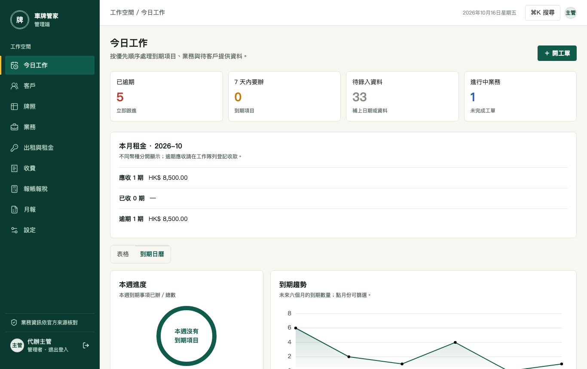

- 上方四格：**已逾期**、**7 天內要辦**、**待錄入資料**、**進行中業務**，點一下即篩選下方工作隊列。
- **本月租金**：本月應收、已收、逾期，按幣種分開。
- 工作隊列每一項都可以：直接填新的到期日（批文卡有效期請回到批文卡修改）、「標記完成」、或開工單。
- 逾期使用費顯示「登記收款」；報帳項目會打開該期，不會出現「標記完成」。
- **客戶自理**的項目（委託範圍設為客戶自理）不會出現在今日工作，只在客戶頁以灰色顯示，並在客戶手機標「請你處理」。

## 2. 客戶

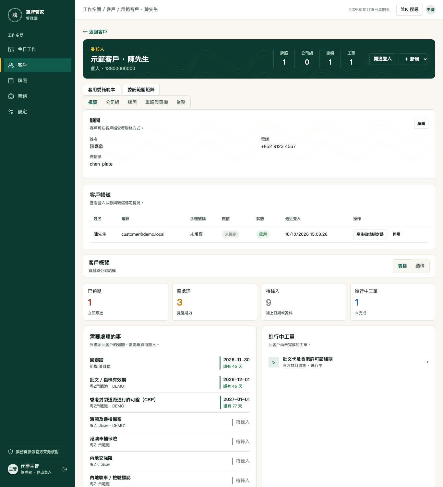

- **頁首**：牌照、公司組、車輛、工單數字；「開通登入」為客戶開帳號（電郵或手機號碼），完成後系統產生一段可直接轉發的文字。
- **顧問**：填姓名、電話、微信號，客戶手機首頁就有致電和複製微信號按鈕。
- **客戶帳號**：看最近登入、是否綁定微信；可產生 6 位**微信綁定碼**（10 分鐘有效）、停用或重新啟用帳號。
- **套用委託範本／委託範圍矩陣**：一次設定每間公司、每個牌照由誰辦（我們做／外包／客戶自理）。
- **車輛與司機**：每個牌照一主兩副司機；證件到期按司機追蹤。

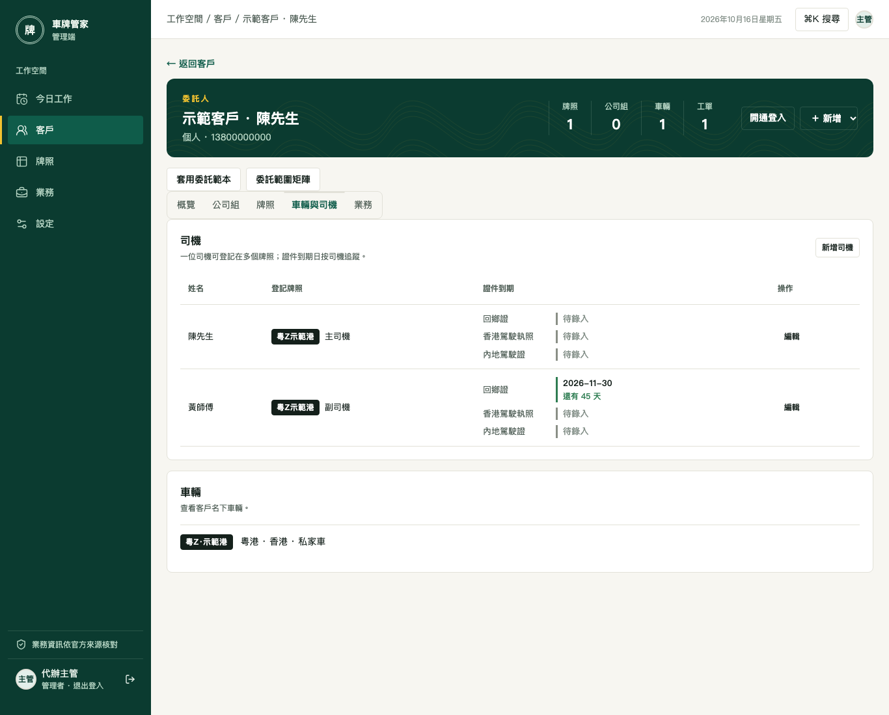

## 3. 牌照

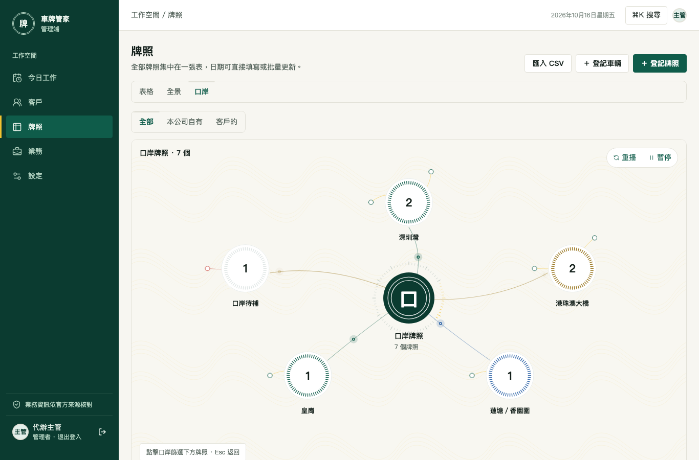

- **表格**：全部牌照一張表，可直接填日期、批量更新、改口岸（只限管理者）。
- **匯入 CSV**：新客戶交來 Excel 時另存為 CSV 匯入；先預覽，錯誤會逐列說明怎樣改，確認後才寫入。
- **全景／口岸**：看全部客戶、公司、牌照之間的關係，或按口岸分佈；點表盤可篩出下方列表。
- 牌照詳情：批文卡（上傳辨識、手動修改、原件核對）、司機、到期項目、委託範圍、過關記錄、出租合約。

## 4. 業務工單

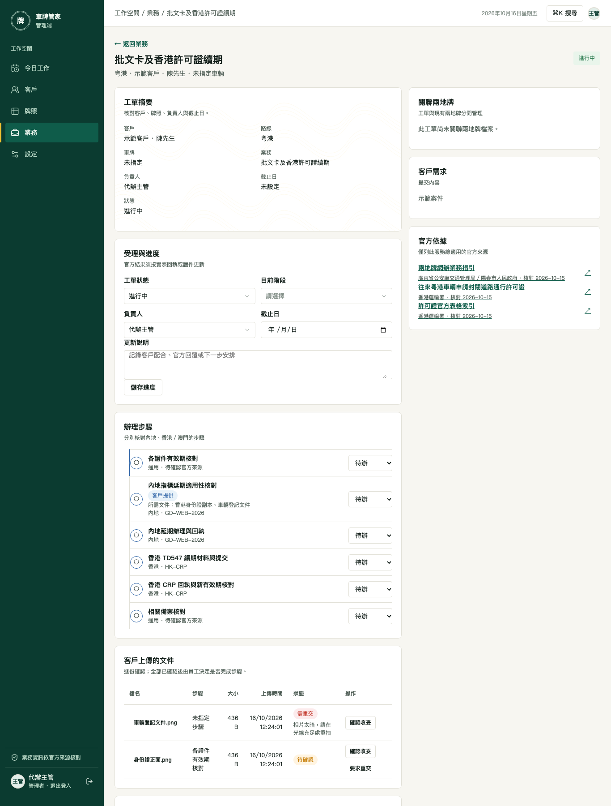

1. 「開工單」選客戶、業務、路線，系統按業務範本帶出步驟。
2. 每一步做完把狀態改為已完成；標為「客戶提供」的步驟會通知客戶在手機上傳文件。
3. 客戶上傳的文件在「客戶上傳的文件」：預覽後按**確認收妥**，或**要求重交**並寫原因。
4. 結案時可一併更新到期日（例如新 CRP 到期日），換司機工單可更新司機登記；管理者結案時可記錄本單收費。

## 5. 出租與租金（只限管理者）

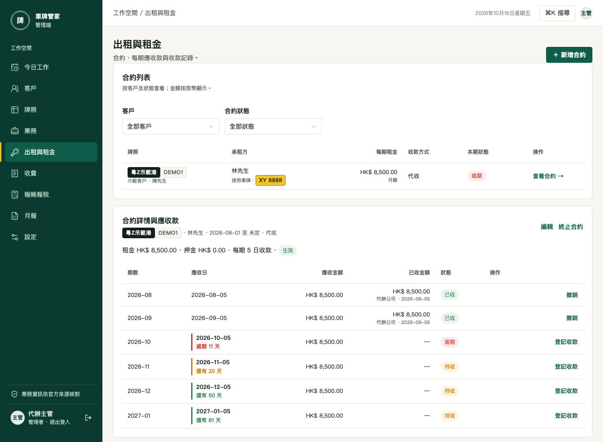

- **合約**：新增合約（承租方、起租日、每期使用費、週期、收款方式：代收或直付、管理費）。生效後自動產生每期應收款；牌照用途自動變為「出租中」。
- 每期可**登記收款**（可附憑證）或**撤銷**；提前**終止合約**後，之後未收的期數作廢。
- **承租方連結**：在合約詳情產生，複製轉發文字給承租方；對方不用登入，輸入電話最後 4 位即可看使用費、上傳轉帳憑證、確認已閱讀。連結只顯示一次，可重發或作廢。

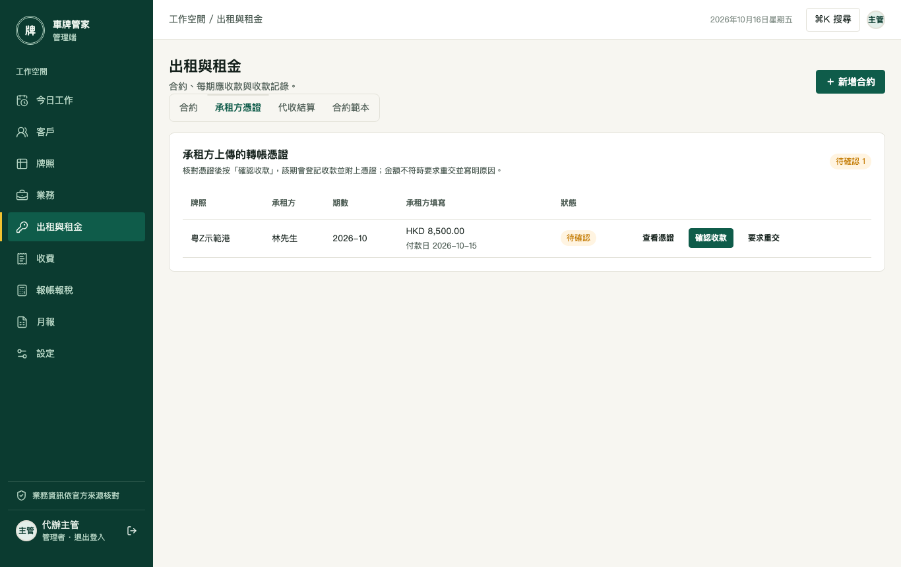

- **承租方憑證**：核對後按「確認收款」，該期自動登記收款並附上憑證；代收的合約會同時產生代收服務費。
- **代收結算**：按客戶彙總當月代收的使用費，扣除服務費得出應付客戶金額；轉帳後按「標記已結算」。
- **合約範本**：承租方頁面的文字，可插入佔位符；對外請寫「車輛使用安排」「使用費」。

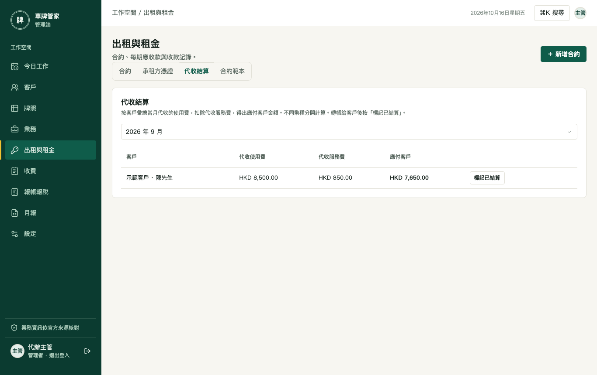

## 6. 收費（只限管理者）

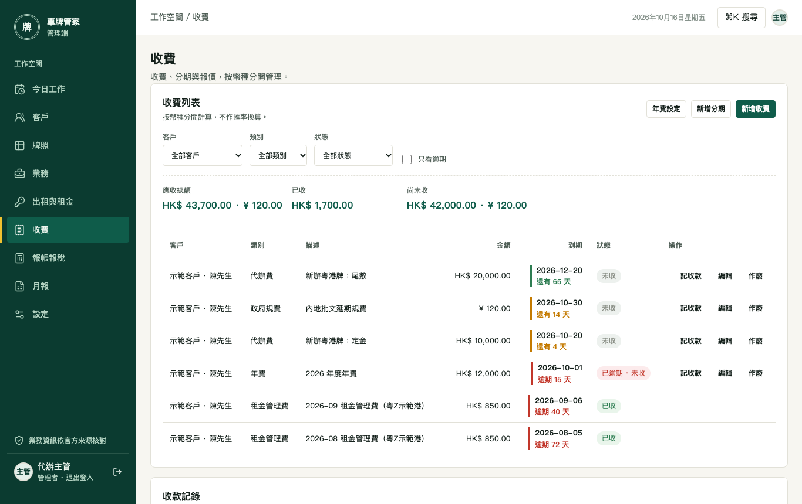

- **收費列表**：按客戶、類別、狀態篩選；上方合計按幣種分開（人民幣、港幣、澳門幣不換算）。
- **新增收費**：代辦費、政府規費、代墊分開記；**年費設定**每位客戶一次，每年到了計費月份自動產生年費。
- **記收款**：可部分收款、附憑證；收足後蓋「已收款」印章。收錯可在收款記錄撤銷；未收款的項目可作廢（要寫原因）。
- **分期**：新辦等大額業務分 2–12 期，每期客戶要在手機確認金額。
- **報價**：草擬 → 發出 → 客戶接受後按「開工單」，結案時會自動帶入報價的預計收費；可列印 A4 報價單。
- **工單結案**：管理者結案時要填本單收費（代辦費、規費、代墊可多筆）；不收費要主動勾「略過本單收費」，避免漏收。
- 代收使用費的管理費（代收服務費）由系統在收到使用費時自動產生，不用手動記。

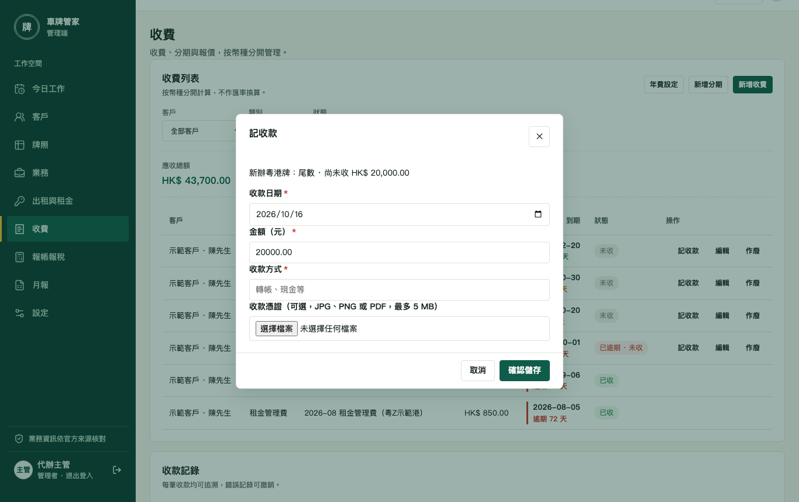

## 7. 報帳報稅（只限管理者）

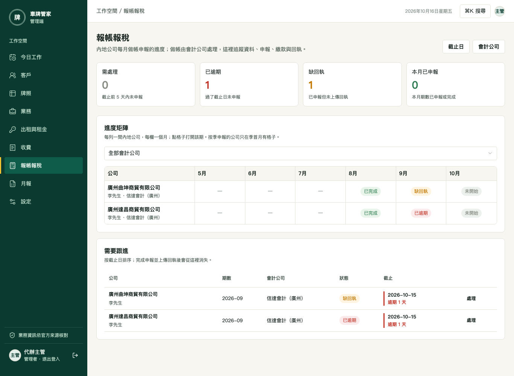

- **進度矩陣**：每列一間內地公司、每欄一個月；點格子打開該期。
- 每期逐步記錄：客戶票據收齊 → 已交會計公司 → 已申報 → 已繳款（零申報只要申報）；上傳回執。
- **會計公司**：新增後在每期詳情指派給公司；**截止日**預設次月 15 日，遇節假日在這裡改。

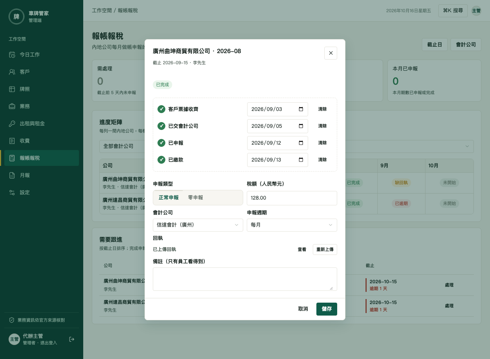

## 8. 月報

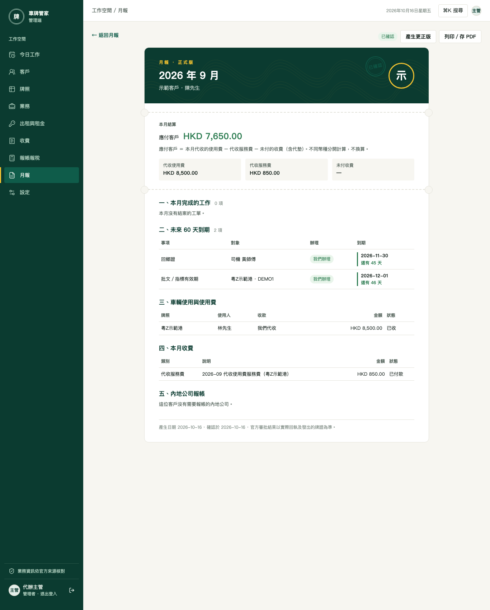

- 每月 1 日自動為每位客戶產生上月草稿。打開核對後按**確認並發給客戶**，客戶手機才看得到。
- 確認後數字鎖定；如需更正按**產生更正版**，舊版保留。
- **列印／存 PDF** 輸出 A4 版面。員工可看，只有管理者可以確認。

## 9. 設定

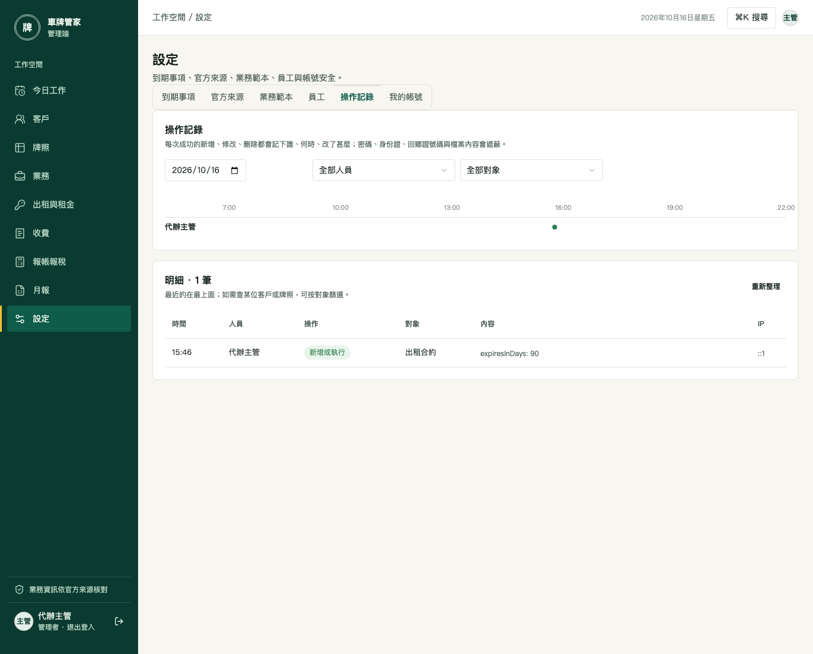

- **到期事項**：調整每條規則的提前提醒天數與條件。
- **員工**（管理者）：新增員工、重設密碼、停用離職員工；「全景」看每位員工可用的功能。
- **操作記錄**（管理者）：誰在甚麼時間改了甚麼；密碼和證件號碼會遮蔽。
- **我的帳號**：修改密碼（至少 10 位）；改後其他裝置需要重新登入。

## 帳號安全

- 密碼輸錯 5 次會鎖 15 分鐘；登入 30 天後或 7 天沒使用要重新登入。
- 員工離職：在「設定 → 員工」停用帳號，該帳號立即登出。
- 客戶反映資料不對：先看「設定 → 操作記錄」，再決定是否修改。
