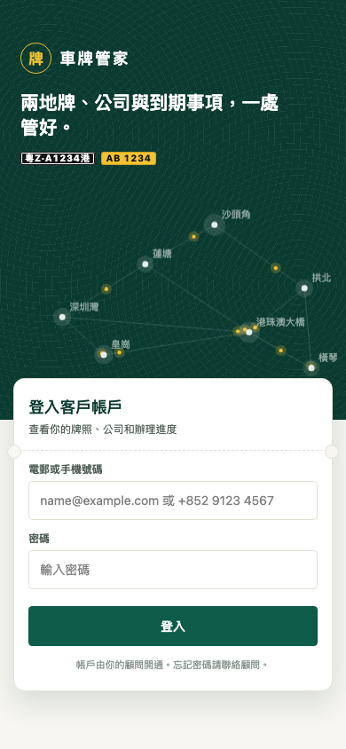
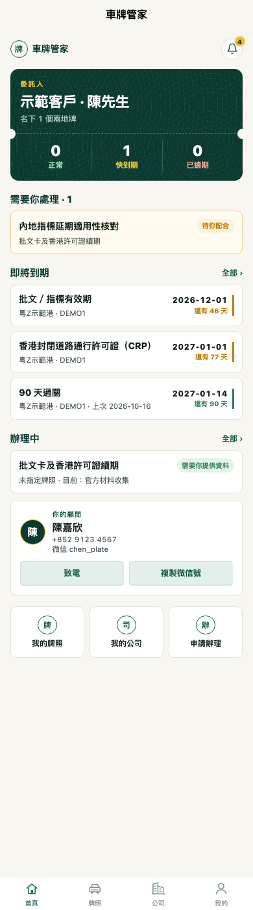
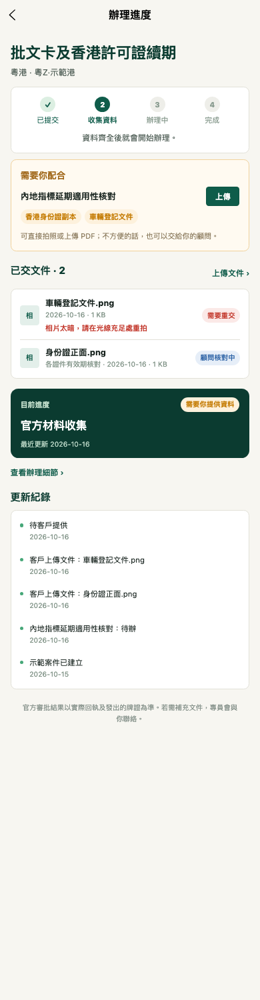
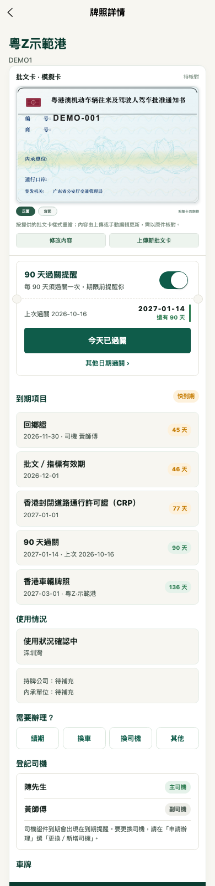
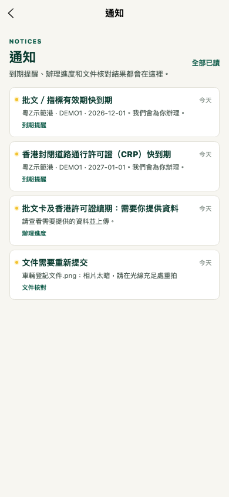
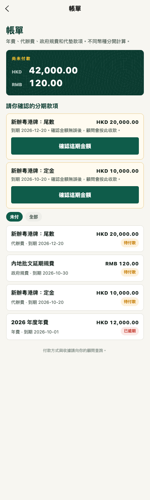
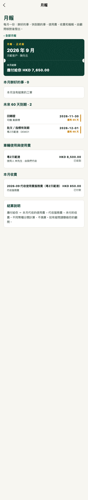

# 車牌管家 · 客戶使用說明

用手機就能看你的兩地牌、公司和辦理進度。帳號由你的顧問開通，顧問會把登入方法傳給你。

## 1. 登入

- 輸入**電郵或手機號碼**和密碼。
- 用微信小程序時，可按「微信快速登入」；第一次要輸入顧問給你的 **6 位綁定碼**（10 分鐘內有效）。
- 忘記密碼請聯絡顧問重設。
- 第一次登入會有 3 步導覽，之後可在「我的 → 使用導覽」重看。

## 2. 首頁一眼看清楚

- **上方**：名下牌照的狀態（正常／快到期／已逾期），點數字可看該類牌照。
- **需要你處理**：顧問需要你提供資料的事；沒有就代表不用操心。
- **即將到期**：按日期排列。標了 <b>請你處理</b> 的要你自己辦；其他由我們為你辦理。
- **右上角鈴鐺**：到期提醒、辦理進度、文件核對結果都會通知你。
- **你的顧問**：可直接致電或複製微信號。

## 3. 交文件：直接拍照上傳

1. 點「需要你處理」的項目，進入辦理進度。
2. 在「需要你配合」按 **上傳**，選「拍照或選相片」或「選擇 PDF 文件」（每份 5 MB 以內）。
3. 上傳後顯示「顧問核對中」；顧問收妥後變「已收妥」。如需重交，會寫明原因並通知你。

## 4. 牌照：到期、90 天過關、司機、使用安排

- **到期項目**：批文、CRP、保險、驗車、司機證件等，按日期排列。
- **90 天過關提醒**：需要時打開開關；過關後按「今天已過關」，系統會算出下次期限。
- **登記司機**：主司機和副司機；要換司機按「換司機」。
- **車輛使用安排**：如牌照安排給他人使用，這裡顯示使用人、每期使用費和是否已收到。

## 5. 通知

點一則通知會直接打開相關頁面；右上角「全部已讀」可一次清除。

## 6. 帳單

- 上方按幣種顯示**尚未付款**的金額（人民幣、港幣、澳門幣分開，不換算）。
- **分期款項**：新辦等大額業務分期收款時，每期要你按「確認這期金額」。
- 付款方式和收據請向顧問查詢。

## 7. 月報

每月初顧問核對後發給你，內容包括：本月辦好的事、已逾期及 60 天內到期、車輛使用與使用費、本月收費、內地公司報帳。最上方一眼看到**應付給你**或**你應付**的金額。如有更正，會顯示「更正版」。

## 常見問題

| 問題 | 怎樣做 |
|---|---|
| 登入顯示「登入失敗次數過多」 | 等 15 分鐘再試，或請顧問重設密碼 |
| 很久沒用被登出 | 超過 7 天沒有使用會自動登出，重新登入即可 |
| 看到的資料不對 | 截圖給顧問；所有修改都有記錄，可以查到原因 |
| 我的助手也想看 | 請顧問為助手另開一個帳號（可用手機號碼開通） |
